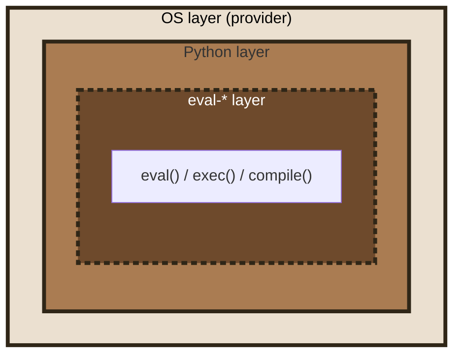

# PY-SANDBOXES
https://github.com/user-attachments/assets/3700b690-0e86-408e-a3e7-e299268bfc25

[](https://pypi.org/project/pysandboxes/)
[](https://pypi.org/project/pysandboxes/)
[](https://pypi.org/project/pysandboxes/)
[](https://github.com/pprados/pysandboxes/blob/master/LICENSE.txt)
[](#platform-support)

> Put `python-sb` in front of `python`: the program can then only touch what a readable policy file allows.

Python programs that run LLM-written code, agent skills, MCP servers or third-party tools usually run with all the rights of the user: every file, the network, every API token. A manipulated model can use them to read local files, reach internal services or run commands ([OWASP LLM05:2025](https://genai.owasp.org/llmrisk/llm052025-improper-output-handling/), [OWASP LLM06:2025](https://genai.owasp.org/llmrisk/llm062025-excessive-agency/)).

**Py-Sandboxes** runs a Python program under an explicit, deny-by-default policy stored in a `.py-sandboxes` text file. It can write a first version of that policy by watching the program run, and you review it like code.

[Home Page](https://www.github.com/pprados/pysandboxes/) | [API reference](https://pprados.github.io/pysandboxes/) | [Wiki](https://github.com/pprados/pysandboxes/wiki)

# See it in 30 seconds

One ordinary script fetches a URL, reads a directory and reads an API key. The policy is learned from its real behavior; then the same script is made to misbehave, as a prompt injection could do (`--evil`):

```text
$ python-sb app/demo.py --evil
[ OK ]    GET https://example.com: HTTP 200, title=Example Domain
[ OK ]    read data/: hello.txt='Hello from the sandbox demo'
[ OK ]    read $DEMO_API_KEY: sk-...
[REFUSED] read an SSH key: RuleFileNotFoundError: Access to '/home/<user>/.ssh/id_rsa' must be accepted by a rule.
[REFUSED] read /etc/passwd: RuleFileNotFoundError: Access to '/etc/passwd' must be accepted by a rule.
[REFUSED] run a shell command: RuleApiPermissionError: os.system() is denied by the API guard (category: process-exec).
[REFUSED] read $AWS_SECRET_ACCESS_KEY: KeyError: 'AWS_SECRET_ACCESS_KEY'
[REFUSED] exfiltrate: URLError: <urlopen error Guard network connection to '[162.159.142.41]:443' DENIED by implicit default policy.>
```

The legitimate work still passes, everything else is refused. The policy that allows it is a handful of readable lines (excerpt):

```text
env=DEMO_API_KEY=${DEMO_API_KEY}
expose-ro=./app
expose-ro=./data
net=ALLOW|TCP|example.com|443|OUT
```

[](https://github.com/pprados/pysandboxes/tree/master/samples/quick-demo)

The [quick demo](https://github.com/pprados/pysandboxes/tree/master/samples/quick-demo) replays this step by step in five minutes, including the case where learning is fooled.

# Quick start

Linux or macOS, Python 3.11.5 to 3.14. Replace `python` with `python-sb` in the command that starts your application:

```bash
uvx python-sb -m my_module          # without installing anything
```

or install it in the application environment:

```bash
pip install pysandboxes
python-sb -m my_module
```

The policy then goes through three steps:

1. **Learn, on code you trust.** With no `.py-sandboxes` file, the first run is a learning run: every access is allowed and recorded in `.py-sandboxes` (use `--learn` to run it again later). That run has **no OS boundary**: it always uses the `subprocess` provider.
2. **Review.** Open the generated `.py-sandboxes`, narrow what is too broad (`expose-ro=~` also covers `~/.ssh`), commit it. Behavior that was not exercised during the run cannot be learned: exercise representative paths.
3. **Enforce.** Run the same command again. The policy is applied, under `landlock` when the Linux kernel supports it (`subprocess` otherwise, with a warning).

This is *complete mode*: the whole application runs under the sandbox. To isolate only some functions and keep the rest of the program free, see [partial mode](#partial-mode-isolate-some-functions).

# Three layers, three different promises

| Layer | What it does | What it does not do |
|---|---|---|
| **Python layer** (`py-sandbox`) | Intercepts file, network, environment, import and sensitive-call APIs and applies the policy. Gives visible, explicit refusals. | Is not a boundary against hostile code: `ctypes`, native extensions and direct system calls bypass it. |
| **Dynamic-code layer** (`eval-*`) | Parses, checks, rewrites and runs strings given to `eval()`, `exec()` and `compile()` under a budget and a timeout. | Applies only to those three entry points, and is not a process boundary. |
| **OS layer** (a *provider*: `landlock`, `bwrap`, `firejail`, `unshare`, `qemu`, `sandbox-exec`) | Applies OS-level restrictions that can constrain compiled code, subject to the selected provider and profile. | Cannot express Python notions (import whitelist, `eval-*`), and each provider has its own limits. Landlock denies native TCP bind/connect by default and requires ABI v4 (Linux 6.7+); it cannot filter UDP. QEMU enforces `expose-ro` with a read-only 9p export. `sandbox-exec` (macOS) filters files and TCP/UDP ports but not remote hosts. |

Defense in depth: use the Python layer to *see and refuse* misuse of legitimate code, add an OS provider when the code itself may be hostile. [Details of the model](https://github.com/pprados/pysandboxes/wiki/security-model).



# Limits, at a glance

Read these before relying on it. They are documented positions, not hidden ones.

- **Not a defense against a malicious dependency** that you installed yourself.
- **The Python layer alone is friction, not isolation.** For untrusted or hostile code, pick a kernel provider (see [choosing a provider](#choosing-a-provider)).
- **Learning is trust.** It records what the code does, including what it should not do. Learn from a trusted run, then review the diff of `.py-sandboxes`.
- **A missing rule file means learning mode, which allows everything.** The effective rights also depend on `include` lines, the environment (`OS_SANDBOX`) and the command line. To lock a policy, see [what the rule file does not show](https://github.com/pprados/pysandboxes/wiki/use-cases#what-the-rule-file-does-not-show) and [Lock the rules](https://github.com/pprados/pysandboxes/wiki/configuration#lock-the-rules). In production, also make the `.py-sandboxes` files read-only for the user running the program ([details](https://github.com/pprados/pysandboxes/wiki/configuration#make-the-rule-files-read-only-in-production)).
- **Controls apply to supported APIs.** They are not unconditional guarantees. Secrets already in process memory are not hidden from native code.
- **Kernel isolation is Linux, plus `sandbox-exec` on macOS.** See [platform support](#platform-support).

Known weaknesses are listed in [weaknesses](https://github.com/pprados/pysandboxes/wiki/weaknesses); what counts as a vulnerability, and how to report one, is in [SECURITY.md](https://github.com/pprados/pysandboxes/blob/master/SECURITY.md).

# Use cases

`python-sb` replaces `python` on a command line, so anything launched as a Python script runs with the rights written in its `.py-sandboxes` file:

- **Agent skills, hooks and plugins**: the scripts of a skill run with all the rights of the user. A rule file shipped with the skill bounds them, and doubles as its permission manifest.
- **Tools, CLIs and MCP servers**: a policy constrains supported file, network, environment, import and sensitive-API operations to declared access.
- **AI coding agents**: the rule file is versioned, so `git diff -- '*.py-sandboxes'` shows every right the agent added between two commits.
- **Dependency updates**: a run without `--learn` turns a new behavior of a dependency into a visible violation.
- **Untrusted tests in CI**, **audit of an unknown script** with `--learn`, **LLM-generated code**.

See [use cases](https://github.com/pprados/pysandboxes/wiki/use-cases) for each scenario and the protection level it needs.

# Partial mode: isolate some functions

Often the core of an application needs all its privileges and only a part should be confined, for example the tools called by an LLM. Mark those functions with `@sandbox` and start the sandbox around the program:

```python
from pysandboxes import sandbox, sandboxes

@sandbox
def my_function_in_sandbox(param):
    ...

with sandboxes():          # or: async with sandboxes():
    my_function_in_sandbox(1)
```

The call is sent to a child process that runs under the policy; the result or the exception comes back to the caller. Arguments and return values must be picklable data. [Complete and partial modes in detail](https://github.com/pprados/pysandboxes/wiki/usage): `init_fn`, `pysandboxes.run()`, notebooks, learning, output capture.

# Choosing a provider

The OS layer is selected with `os-sandbox=<provider>` in `.py-sandboxes`, or for one run with `OS_SANDBOX=<provider> python-sb ...` where the profile reads that variable.

| Situation | Provider |
|---|---|
| Default on Linux, nothing to install, no privilege (files and TCP ports) | `landlock` |
| Untrusted native code, or host and UDP filtering | `bwrap` or `unshare` |
| Strongest separation, a VM (slower: more than 20 s to start) | `qemu` |
| Resource limits and seccomp | `firejail` |
| Inside Docker or Podman | `landlock` or `qemu` unprivileged; `unshare` or `bwrap` with `--privileged` |
| Files and ports on macOS (no host filtering) | `sandbox-exec` |
| Only process separation, no OS boundary (also macOS, Windows) | `subprocess` |

`landlock` denies TCP bind/connect by default when Landlock ABI v4 is available (Linux 6.7+); it cannot filter UDP, hide denied paths, or protect the host's named Unix sockets. Below ABI v4, Landlock is unavailable rather than silently running without its default TCP boundary. Against native code that needs UDP or Unix-socket isolation, use `os-sandbox=bwrap` or `unshare`. QEMU applies `expose-ro` through a read-only 9p export. A named provider is never silently downgraded: if it is unavailable, the sandboxed process fails closed. The [provider comparison](https://github.com/pprados/pysandboxes/wiki/os-providers) gives the full matrix and limits.

# Platform support

| Platform | Python layer | OS providers |
|---|---|---|
| Linux | yes | `landlock`, `bwrap`, `firejail`, `unshare`, `qemu`, `subprocess` |
| WSL | yes | the Linux providers, where the kernel and tooling requirements are met |
| **macOS** | yes | `sandbox-exec` ([Seatbelt](https://github.com/pprados/pysandboxes/wiki/sandbox-exec): files and ports, but no remote host or IP filtering) and `subprocess` |
| Windows | yes | `subprocess` only: **no** OS isolation |

Kernel-backed providers (`landlock`, `bwrap`, `firejail`, `unshare`, `qemu`) are Linux technologies. The Python layer, and `sandbox-exec` on macOS, are exercised by the [cross-OS workflow](https://github.com/pprados/pysandboxes/blob/master/.github/workflows/cross-os.yml). Provider prerequisites: [provider comparison](https://github.com/pprados/pysandboxes/wiki/os-providers).

# Why trust it, and how it compares

- **Weaknesses are published**, not hidden: [weaknesses](https://github.com/pprados/pysandboxes/wiki/weaknesses), and two attack-by-attack assessments, [Python layer](https://github.com/pprados/pysandboxes/wiki/audit-python-security) and [`eval-*`](https://github.com/pprados/pysandboxes/wiki/audit-eval-security), each finding linked to a regression test.
- **Tests are mapped**: guard families, providers and container conditions in the [test coverage map](https://github.com/pprados/pysandboxes/wiki/tests), skipped scenarios included.
- **Compared with the alternatives**: [eighteen other solutions](https://github.com/pprados/pysandboxes/wiki/alternatives) (RestrictedPython, containers, microVMs, hosted services), read from source or documentation, on a common 45-feature grid.
- **Research background**: [Confining Python by observation](https://github.com/pprados/pysandboxes/blob/master/research/confining-python-by-observation.md).

# Samples

The [sample suite](https://github.com/pprados/pysandboxes/wiki/samples) holds integrations for MCP servers and agent frameworks, with worked examples and test instructions. Start with the [quick demo](https://github.com/pprados/pysandboxes/tree/master/samples/quick-demo), then the [MCP server demo](https://github.com/pprados/pysandboxes/blob/master/samples/mcp-server-demo/README.md): a server that fetches a web page can be abused to read `localhost`, the intranet or `file:///`.

# Documentation

The [wiki index](https://github.com/pprados/pysandboxes/wiki) groups the documentation by task and proposes reading paths: 5 minutes, 30 minutes, security review. For the code, read the [architecture page](https://github.com/pprados/pysandboxes/wiki/implementation). To run the current source checkout during development:

```bash
uv sync --group test
uv run python-sb --help
```
