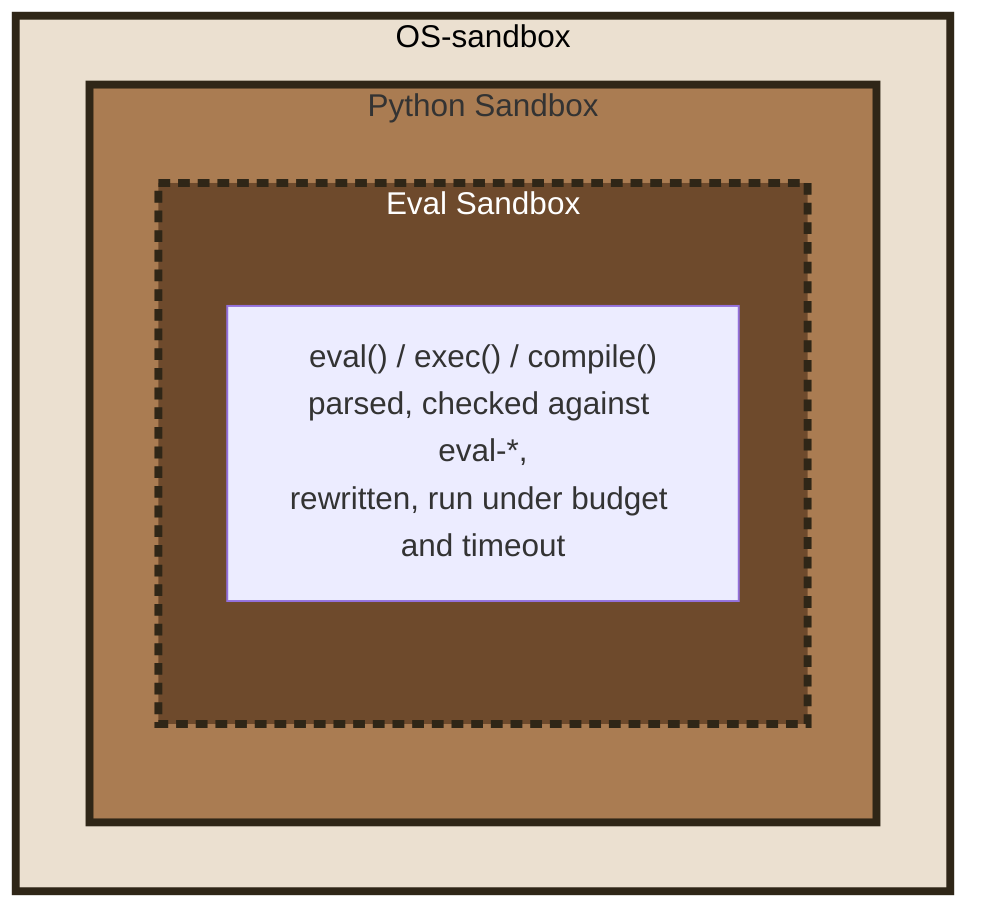

# Security model

The [README](../README.md) gives the three layers and the limits in a few lines. This page explains the reasoning and lists the filters.

## Why

It is not easy to control the code that an LLM will execute. It can generate Python code that is invoked directly, or describe the launch of a tool that the application will run with parameters provided by the LLM, directly through a function or indirectly through an API or an [MCP call](https://modelcontextprotocol.io/). Developers also increasingly use AI to improve code: without rigorous verification, generated code can open security vulnerabilities.

An MCP server that exposes a service to view a web page can be abused to request a page on `localhost`, an address on the intranet, a swagger documentation, or `file:///` to read local files. Code generated by an LLM can build a crafted regular expression to cause a denial of service or an infinite loop. Demos are in [the MCP server sample](https://github.com/pprados/pysandboxes/blob/master/samples/mcp-server-demo/README.md).

Is it wise to let every piece of Python code, or every dependency, access all the files of the application? The aim is to control, as much as possible, the capabilities granted to each component.

## Defense in depth

Several layers support each other to limit the capabilities and privileges of each component:

- The **Python layer** (`py-sandbox`) filters and strengthens standard Python APIs. This interception is effective but cannot guarantee that there is no workaround.
- The **OS layer** (`os-sandbox`) relies on the operating system to limit network, disk and other accesses. Nesting it around the Python layer is the recommended combination.
- The **dynamic-code layer** (`eval-*`) checks strings handed to `eval()`, `exec()` and `compile()`. It is not a process boundary: the source is parsed, checked against the `eval-*` rules and rewritten inside the very process that calls `eval()`, which is why it is drawn with a dashed border.

This is a capability-oriented design. It is not equivalent to [AppArmor](https://apparmor.net/) or to another operating-system policy framework. The configuration follows **least privilege**: guarded operations are denied unless a rule permits them. This does not mean that every possible Python or native operation is intercepted.

## Risks addressed, and how far

The controls apply to supported APIs and depend on the selected OS provider; they are not unconditional guarantees.

- **Path traversal**: guarded file APIs enforce configured path rules; use an OS provider for a boundary against native code.
- **Sensitive process execution**: registered APIs are denied by default and require an explicit `python-api=` permission.
- **Reverse shells and remote access**: supported network operations can be constrained by `net=` rules and the selected OS provider.
- **Excessive permissions and token exposure**: file and environment rules limit access through supported APIs. They do not hide secrets already present in process memory from native code.
- **Dynamically evaluated code**: `eval()`, `exec()` and `compile()` are checked against the declared sub-language in the [`eval-*` rules](eval.md).
- **Denial of service in evaluated strings**: iteration, recursion, allocation and timeout limits apply to the `eval-*` runtime; these are not general process resource limits.
- **Unapproved syntax in evaluated strings**: `eval-syntax=` restricts the allowed syntax constructs.

## The filters

- **Environment variables**: the variables visible in the sandbox are limited. Mapping rules forward sets of variables from the outside to the inside (e.g. `env=*_API_KEY=${*_API_KEY}`).
- **Network access**: direction, IP addresses, domain names and ports available to the sandbox.
- **Disk access**: directories are mapped to their equivalent in the sandbox, read-only or read and write. File filters ignore some files (e.g. `ignore=.*`).
- **Imported modules**: a whitelist of the Python modules accessible to the sandbox. Importing others is rejected.
- **Sensitive API calls**: a registry of sensitive functions (`os.system`, `subprocess.Popen`, `os.kill`, ...) is denied by default, regardless of `python-import=`: an import right is not a call right. Permissions can be granted per function or category. Learning records the supported calls it observes; it does not discover calls made through native code.
- **Dynamically evaluated code**: a string handed to `eval()`, `exec()` or `compile()` is refused unless the profile declares the sub-language it may use.

The [generated parameter file](https://github.com/pprados/pysandboxes/blob/master/pysandboxes/templates/py-sandboxes.template) documents every rule. Each key of the `eval-*` family is described, with a valid and an invalid example, in [eval.md](eval.md).

## Learning mode

Learning mode records supported accesses observed during a run, and gives an initial inventory. It does not prove that the policy is complete: unexercised paths and accesses outside supported APIs may be absent. Review the policy, and test the application in enforcement mode before deployment. A network call made by compiled code is not seen during learning: add the rule by hand, the OS provider will refuse it otherwise.

## Where the attacks are analysed

- [Security assessment of the Python layer](audit-python-security.md): attack by attack, what hostile code can and cannot reach once a profile is armed, which layer stops each attempt and what the layer does not claim to cover.
- [Security assessment of the `eval-*` guard](audit-eval-security.md): the same for a hostile string.
- [Weaknesses](weaknesses.md): known limits and residual risks.
- [Provider comparison](os-providers.md): what each OS mechanism enforces.
