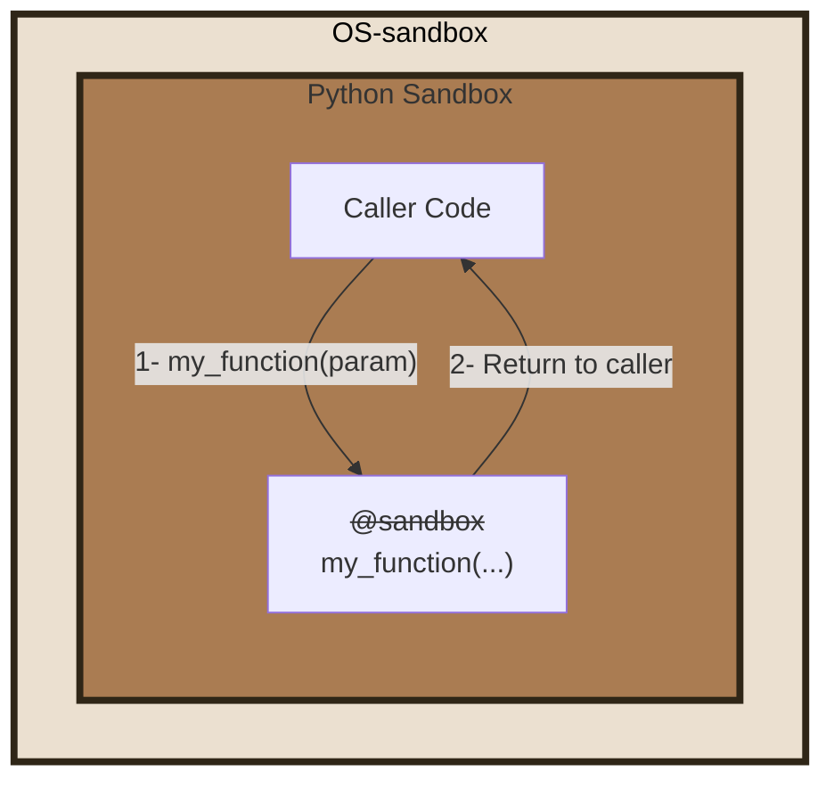
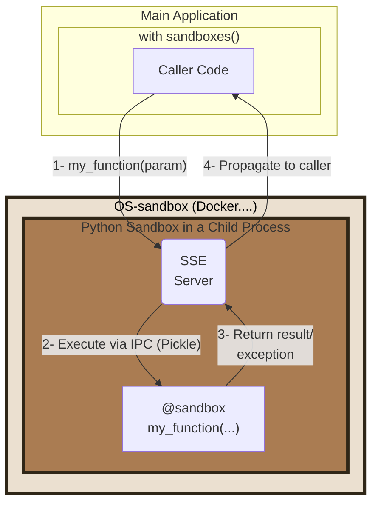

# Usage: complete mode and partial mode

See the [README](../README.md) for a quick start. This page documents the two usage modes.

The public API is four things:

- a command line: `python-sb`
- a function: `run`
- a context manager: `sandboxes`
- a decorator: `@sandbox`

| | Complete mode | Partial mode |
|---|---|---|
| What is sandboxed | The whole application | Only the functions marked `@sandbox` |
| How | Launch with `python-sb` instead of `python` | `with sandboxes():` and `@sandbox` in the code |
| Code change | None | Yes, a few lines |
| Privileges | The whole application gets the same rights | The core keeps its rights, the sandbox gets fewer |
| Typical use | MCP server, script, agent skill, CLI | Tools called by an LLM inside an application that needs tokens or files |

## Complete mode



Complete mode needs no code changes. Replace `python` with `python-sb`. The `@sandbox` decorator has no effect in this mode. Pass rules before the module name:

```shell
python-sb --learn -m my_module
```

Start an interactive session with `python-sb`. Python's standard options remain available. If IPython is installed, it is used:

```shell
> python-sb
SANDBOXES Python 3.13.5 | packaged by Anaconda, Inc. | [GCC 11.2.0] on linux
**APIs are LIMITED according to the rules in '.py-sandboxes'**
Type "help", "copyright", "credits" or "license" for more information.
IPython 8.37.0 -- An enhanced Interactive Python. Type '?' for help.

⚠ In [1]: import os
⚠ In [2]: os.open??
Signature: os.open(path, flags, mode=511, *, dir_fd=None)
...
```

Complete mode suits standalone scripts, CLIs, and [MCP](https://modelcontextprotocol.io/specification/2025-06-18) servers. It can also run generated code with access limited to libraries such as [NumPy](https://numpy.org/), [SciPy](https://scipy.org/), and [SymPy](https://www.sympy.org/). See the [MCP guide](mcp.md).

### Learning

Run the first launch in learning mode. Exercise representative paths, then review the generated policy. Unobserved paths and unsupported APIs may not appear in the rules.

To restart a learning session and add missing rules:

- activate the `learn` parameter in the configuration file
- or add `--learn=.py-sandboxes` (or just `--learn`) when you start `python-sb`

Learning records supported accesses observed during that run. Review every generated rule before using the profile.

### Limit

Complete mode grants one policy to the whole application, including code that can access API tokens. Use partial mode when only selected functions need isolation.

### Use with uvx

[uvx](https://docs.astral.sh/uv/guides/tools/) runs a Python tool in a temporary environment. The `python-sb` package provides the CLI and depends on `pysandboxes`:

```bash
uvx python-sb --help
```

## Partial mode

Use partial mode when the application needs full privileges but selected functions need fewer. For example, limit the files and environment variables available to tools invoked by an LLM.

The application is split in two parts:

- The core of the application, with all privileges.
- A sandbox, where the code annotated with `@sandbox` is executed.



### Launching the sandbox

In your program, launch the sandbox before isolating parts of the code.

```python
# Synchronous version
from pysandboxes import sandboxes

with sandboxes(init_fn=init_sandbox):
    ...
```

```python
# Asynchronous version
from pysandboxes import sandboxes

async with sandboxes(init_fn=init_sandbox):
    ...
```

`init_fn` is optional. It runs during sandbox initialization. Use it to:

- log level initialization
- opening database connection pools
- initialize other resources required inside the sandbox.

```python
def init_log_level():
    sandboxes_level = logging.WARNING
    format = '[%(process)d] %(levelname)-5s %(name)s %(message)s'
    if is_in_sandbox():
        format = "  " + format
    logging.basicConfig(
        level=min(sandboxes_level, logging.INFO),
        format=format
    )
    logging.getLogger("Pysandboxes").setLevel(logging.INFO)
    logging.getLogger("pysandboxes").setLevel(sandboxes_level)

def init_fn():
    init_log_level()
    ...
```

For asynchronous use, you can initialize your application this way:

```python
import pysandboxes
...
async def main():
    ...

if __name__ == "__main__":
  pysandboxes.run(main())  # in place of asyncio.run(main())
```

Call the same initialization function in `main()` and in the sandbox with this pattern:

```python
async def init_app():
    # Run in main() and in the sandbox
   ...

async def main():
    await init_app()
    ...

if __name__ == "__main__":
    pysandboxes.run(main(), init_fn=init_app)  # in place of asyncio.run(main())
```

To restart a learning session in partial mode, add `learn='.py-sandboxes'` to `sandboxes()` or to `run()`:

```python
pysandboxes.run(main(),
                learn='.py-sandboxes',
                )
```

### Executing a function in the sandbox

To declare that a function must run in the sandbox, annotate it with `@sandbox`.

```python
# file my_module.py
from pysandboxes import sandbox

@sandbox
def my_function_in_sandbox(param):
    ...
```

Once the sandbox is launched, upon invocation of this function, the component converts the call into a Pickle-formatted request, sends it to the sandbox, and waits for the result or exception to be returned to the caller.

> All parameters and the return type must be Pickle-compatible. By default the return value must be a value: primitive data and containers, paths, dates and time zones, decimals, fractions, UUIDs or IP addresses. Add `remote-result-mode=objects` to the rules to return other objects (see [the transport guard](transport-unpickle-guard.md)).

The sandbox receives the request, loads the corresponding module, finds the function, and invokes it. The response is converted into a Pickle-formatted response before being returned to the caller.

- If an exception is raised in the sandbox, the stack trace is propagated to the main application to allow a stack analysis as if the call had been made directly.
- If the application writes to *stdout* or *stderr*, the stream is captured by the sandbox and returned to the caller. The caller then writes to its own *stdout* and *stderr* streams, so the output of the sandbox is not lost nor mixed between threads. It is written in the correct process, in the same async loop.

See also [the FAQ](faq.md) for notebooks and for catching rule violations.
